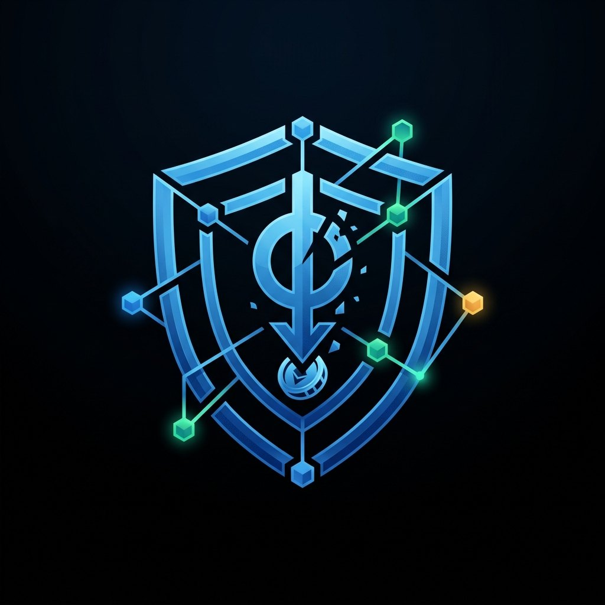

<div align="center">



# Aegis Liquidations

**A multi-chain liquidation bot platform for EVM Layer-2 networks.**

It watches lending protocols on Base, Arbitrum and Optimism, finds under-collateralised loans as
soon as they can be liquidated, prices the opportunity after gas, and alerts you on Telegram.


</div>

---

## What is this?

Lending protocols such as **Aave** and **Compound** let users borrow against collateral. Every
position has a **health factor (HF)**: the risk-adjusted value of the collateral divided by the
debt. When prices move and the HF drops **below 1**, anyone may *liquidate* the position. The
liquidator repays part of the debt and receives the borrower's collateral at a discount: the
**liquidation bonus**, typically 1–10%. This keeps the protocol solvent, and the liquidator keeps
the spread.

Liquidations are a race. A position becomes liquidatable in a specific block, and many bots
compete for it. **Aegis** is built to win that race on L2s. Its job breaks into four steps:

1. **Know every borrower.** It indexes protocol events and keeps a local database of all accounts
   with debt.
2. **Notice risk early.** Positions close to liquidation are re-checked on every block, and an
   oracle price move triggers an immediate rescan of the whole market.
3. **Price it honestly.** It computes the real liquidation terms of each protocol (close factor,
   eMode bonus, protocol fee, dust rules) and subtracts gas, including the L1 data fee that L2s
   charge.
4. **Act.** In **V1** "act" means a rich Telegram alert. From **V2** the bot will execute the
   liquidation itself through its own smart contract, with flash loans.

> **Current status: V1 — read-only detector.** It holds no private keys and never sends a
> transaction. It is safe to run on your laptop and shows what Aegis sees.

## Features

| | |
|---|---|
| 🌐 **Multi-chain** | Base, Arbitrum One and Optimism, one async provider per chain with RPC fallbacks |
| 🏦 **Protocols** | Aave v3 (including eMode and the v3.3 close-factor and dust rules) and Compound v3 / Comet (absorb + `buyCollateral`) |
| ⚡ **Low-latency watcher** | Synchronised with block production. Re-checks near-liquidation positions every block and starts a full rescan on any oracle move of 0.5% or more |
| 💰 **Accurate profit** | Liquidation bonus minus gas. Gas covers L2 execution plus the L1 data fee (OP-stack `GasPriceOracle`, Arbitrum `NodeInterface`) and is priced in USD with Chainlink. All money math uses `int` wei and `Decimal`, never `float` |
| 🔎 **Borrower indexer** | Checkpointed `eth_getLogs` indexing with adaptive chunk sizes and reorg safety |
| 📦 **Batched reads** | Multicall3 everywhere: thousands of positions checked in a few RPC calls |
| 🚦 **RPC budget** | A Redis token bucket shared by all services keeps usage under the provider's compute-unit limit, with a reserved share for the watcher |
| 📨 **Telegram** | HTML alerts for every opportunity, a startup message and an hourly status report |
| 🐳 **Dockerized** | One `make up-local`: Postgres, Redis, migrations, Celery workers, the watcher and beat, with healthchecks and a strict start order |
| 🧱 **Clean architecture** | SOLID with strategy-pattern adapters. A new chain or protocol is a new class plus a registry entry. Fully typed (`mypy --strict`) and tested |

## Supported markets (V1)

| Network | Aave v3 | Compound v3 (Comet) |
|---|---|---|
| **Base** | ✅ | cUSDCv3, cWETHv3 |
| **Arbitrum One** | ✅ | cUSDCv3, cUSDC.ev3, cUSDTv3, cWETHv3 |
| **Optimism** | ✅ | cUSDCv3, cUSDTv3, cWETHv3 |

Contract addresses and their sources are documented in
[`src/aegis/config/chains.py`](src/aegis/config/chains.py). Each one was verified on-chain.

## What you get in Telegram

<table>
<tr>
<td width="50%" valign="top">

**🚨 Liquidation opportunity**
```
🚨 Liquidation Opportunity
━━━━━━━━━━━━━━━━━━
🌐 Network: Base
🏦 Protocol: Aave v3 · Aave v3
👤 Borrower: 0x1111…1111
🔴 Health Factor: 0.9712
━━━━━━━━━━━━━━━━━━
💳 Debt to cover: 1,000 USDC (≈ $1,000.00)
💎 Collateral: WETH (seize ≈ $1,050.00)
🎁 Liquidation bonus: 5.00%
⛽ Gas (L2 + L1 data): $0.0312
━━━━━━━━━━━━━━━━━━
💰 Est. net profit: $44.97
```

</td>
<td width="50%" valign="top">

**📊 Hourly status report**
```
📊 Aegis status · last 1h
━━━━━━━━━━━━━━━━━━
🌐 Base
  • Aave v3: 1840 borrowers · debt $212.4M
    · ⚠️ 4 at risk · min HF 1.021 · ✅ synced
🌐 Arbitrum One
  • Aave v3: 5120 borrowers · debt $640.0M
    · ⚠️ 11 at risk · ⏳ indexing, ~2h behind
━━━━━━━━━━━━━━━━━━
🔎 Opportunities: 0
📨 Alerts sent: 0
💓 Last scan: 4s ago
```

</td>
</tr>
</table>

## Roadmap

| Version | Scope | Status |
|---|---|---|
| **V1** | Read-only opportunity detector and Telegram alerts | ✅ done |
| **V2** | `AegisLiquidator` smart contract; flash loans (Aave, Balancer, Equalizer) behind an `ALLOW_FLASH_LOANS` kill switch; a Dynamic Liquidity Router (self-fund → flash loan → skip); on-chain execution with simulation; competitive-latency work (Flashblocks, Timeboost, pre-signed txs); VPS deployment and CI/CD; daily and monthly reports | planned |
| **V3** | FastAPI admin dashboard (auth, analytics, Chart.js); plugin system for more L2/L3 chains, DEX aggregators and lending protocols | planned |

The detailed checklist is in [`todo.md`](todo.md).

## How V1 works

```
                ┌──────────────┐  60s / 30s     ┌──────────────────────────┐
                │ celery-beat  │ ─────────────▶ │ scanner (Celery, -Q scan) │
                └──────────────┘                │ index : eth_getLogs → borrowers
                                                │ full  : HF of all active borrowers
                                                └──────────┬───────────────┘
                ┌──────────────────────────┐               │
                │ watcher (asyncio, 1/chain)│ every block:  │
                │ • all oracle prices (1 multicall) → move ≥ 0.5% ⇒ immediate full rescan
                │ • HF < 1.05 hot set re-check  │           │
                └──────────────┬───────────┘               │
              Multicall3 batched eth_call                  │ HF < 1 & net profit ≥ MIN_PROFIT_USD
   Base / Arbitrum / Optimism RPC  ◀──────────────────────┤ Redis dedup (SET NX EX)
                                                           ▼
   ┌──────────┐   opportunities, borrowers,   ┌─────────────────────────┐   HTML message
   │ Postgres │ ◀──── checkpoints ────────────│ notifier-worker (-Q notify) ─────────▶ Telegram
   └──────────┘                               └─────────────────────────┘
```

1. **Borrower discovery.** The indexer scans `Borrow` events (Aave v3) and base `Withdraw` events (Comet) in adaptive `eth_getLogs` chunks. It checkpoints the last block for each market and stays `reorg_safety_blocks` behind the chain head.
2. **Health scan.** The scanner batches `getUserAccountData` (Aave) and `isLiquidatable` + balances (Comet) through Multicall3. It stores the latest HF for each borrower. A full scan of all active borrowers runs every `SCAN_INTERVAL_SECONDS`.
3. **Fast watcher (detection latency).** A dedicated asyncio service runs one loop per chain, synchronised with block production. After each block it sleeps about one block interval and then polls the head every `WATCHER_HEAD_POLL_MS` until the next block appears. On every new block it does two things concurrently:
   - Reads every oracle price of all markets on the chain in **one** Multicall3 request. If any price has moved by `WATCHER_PRICE_MOVE_BPS` or more since the last snapshot, a full rescan of that market starts at once in the background.
   - Re-checks the hot set: borrowers with an HF below `WATCHLIST_HF_THRESHOLD`.

   The effective tick is `max(block time, WATCHER_MIN_INTERVAL_MS)`. That is every block on Base/Optimism (2 s) and 1 s on Arbitrum by default. Lowering it on Arbitrum costs more RPC requests. Run `make rpc-latency` to compare how fresh your RPC endpoints are. The freshest node should come first, because a node that serves new blocks late caps detection speed.
4. **Profit estimate (self-funded).**
   - **Aave v3 (v3.3 rules):**
     - The close factor is 50% of the *total* debt. It rises to 100% of the reserve debt when HF < 0.95 or a leg is below $2k.
     - Partial liquidations must leave at least $1k of debt and of collateral.
     - The liquidation bonus comes from eMode when the user is in an eMode category and the collateral belongs to it; otherwise it is the reserve bonus. The protocol fee is deducted from the bonus.
   - **Comet:** `absorb` followed by `buyCollateral` at `storeFrontPriceFactor × (1 − liquidationFactor)`.
   - **Gas:** protocol gas baseline × gas price (+20% margin) + L1 data fee. The L1 fee comes from the OP-stack `GasPriceOracle` on Base/Optimism and from `NodeInterface.gasEstimateL1Component` on Arbitrum. It is priced in USD with Chainlink ETH/USD.
5. **Alert.** If net profit ≥ `MIN_PROFIT_USD`, the opportunity is stored and the alert is queued. Redis prevents a repeat alert for the same borrower within `ALERT_DEDUP_TTL_SECONDS`.

## Quickstart

Requirements: Docker with Compose v2, an [Alchemy](https://dashboard.alchemy.com) key with Base,
Arbitrum and OP Mainnet enabled, and a Telegram bot from [@BotFather](https://t.me/BotFather).
For development you also need [uv](https://docs.astral.sh/uv/).

```bash
cp .env.example .env      # fill TELEGRAM_BOT_TOKEN, TELEGRAM_CHAT_ID, ALCHEMY_API_KEY, POSTGRES_PASSWORD
make up-local             # build and start the stack
make ps-local             # all services should become "healthy"
make logs-local           # follow logs
make rpc-latency          # optional: compare how fresh your RPC endpoints are
make down-local
```

The services start in a strict order:
1. `postgres` and `redis` become healthy.
2. `migrate` runs `alembic upgrade head` and exits.
3. `scanner` and `notifier-worker` start and pass `celery inspect ping`.
4. `watcher` and `celery-beat` start. Each is reported healthy once it writes a heartbeat.

When the scanner is ready, it posts **🟢 Aegis scanner online** to Telegram. Every `STATUS_REPORT_INTERVAL_HOURS` it also posts a **📊 Aegis status** report. The report shows tracked borrowers and their debt, positions close to liquidation, indexer progress, and the opportunities and alerts of the period, so you can tell the bot is alive even when no liquidations occur.

On the first run the indexer backfills `INDEXER_LOOKBACK_DAYS` of events. This takes from a few minutes to about an hour, depending on the RPC plan. Progress shows up in the `index_synced` log lines.

> Profitable liquidations are rare in calm markets. A quiet Telegram does not mean the bot is
> idle. Check the hourly status report.

## Project layout

```
src/aegis/
  config/      settings (pydantic-settings) and the static chain / protocol registry
  core/        domain models, interfaces, errors, ABI helpers, DI container
  chains/      EvmChainProvider, OP-stack / Arbitrum L1-fee providers, RPC cost accounting
  protocols/   Aave v3 and Compound v3 adapters (BaseLendingProtocol)
  scanner/     event indexer, health-factor scanner, orchestrator, block-synchronous watcher
  estimator/   Chainlink native price oracle, gas estimator, profit estimator
  notifier/    Telegram notifier and HTML templates
  reporting/   periodic status report
  workers/     Celery app and tasks, watcher service, Redis tools, healthchecks
  db/          SQLAlchemy models, repositories, session factory
  tools/       operational CLIs (rpc_latency)
migrations/    Alembic
docs/assets/   images used by the documentation
tests/         unit (default) and integration (RUN_INTEGRATION=1)
```

## Development

```bash
make install       # uv sync --all-groups
make check         # ruff format check + ruff lint + mypy --strict + pytest
make test ARGS="tests/unit/test_aave_v3.py -k close_factor"

# Integration tests: repositories + an anvil fork of Optimism
# (Foundry: `curl -L https://foundry.paradigm.xyz | bash && foundryup`).
# DB tests use an isolated `<POSTGRES_DB>_test` database on 127.0.0.1:5433 (`make up-local`),
# never the bot's own data; they are skipped if PostgreSQL is unreachable.
make test-integration
FORK_URL_OPTIMISM=https://opt-mainnet.g.alchemy.com/v2/<key> make test-integration ARGS=-k anvil
```

Adding a chain or a lending protocol never touches the orchestrator:
- **Chain:** add a `ChainConfig` to `aegis/config/chains.py`. If it needs a custom L1-fee provider, register one in `aegis/chains/__init__.py`.
- **Protocol:** implement `BaseLendingProtocol`, then register a factory with `@PROTOCOLS.register("name")`.

## Configuration reference

All settings come from environment variables or `.env`. See [`.env.example`](.env.example) for the full list.

| Variable | Default | Description |
|---|---|---|
| `TELEGRAM_BOT_TOKEN` | — (required) | Bot token from @BotFather |
| `TELEGRAM_CHAT_ID` | — (required) | Target chat / group / channel id |
| `ALCHEMY_API_KEY` | — | One key for Base, Arbitrum and OP Mainnet |
| `BASE_RPC_URLS`, `ARBITRUM_RPC_URLS`, `OPTIMISM_RPC_URLS` | empty | Extra comma-separated RPC URLs. They are tried before Alchemy and act as fallbacks |
| `ENABLED_CHAINS` | `base,arbitrum,optimism` | Chains to monitor |
| `MIN_PROFIT_USD` | `5` | Minimum net profit (after gas) to alert |
| `WATCHLIST_HF_THRESHOLD` | `1.05` | HF below which the watcher re-checks a borrower on every block |
| `MIN_DEBT_USD` | `10` | Dust filter |
| `INDEX_INTERVAL_SECONDS` / `SCAN_INTERVAL_SECONDS` | `60` / `30` | Indexer and full-scan schedules |
| `WATCHER_MIN_INTERVAL_MS` | `1000` | Minimum time between watcher ticks. The effective tick is `max(block time, this)` |
| `WATCHER_HEAD_POLL_MS` | `200` | Head polling period while the watcher waits for the next block |
| `WATCHER_PRICE_MOVE_BPS` / `WATCHER_RESCAN_COOLDOWN_SECONDS` | `50` / `5` | Oracle price move that triggers an immediate full rescan, and the cooldown between such rescans |
| `INDEXER_LOOKBACK_DAYS` | `30` | First-run backfill window |
| `INDEXER_LOG_CHUNK_BLOCKS` | `2000` | Initial `eth_getLogs` range. It shrinks automatically when the RPC rejects a request |
| `ALERT_DEDUP_TTL_SECONDS` | `3600` | Suppress repeat alerts for the same borrower |
| `STATUS_REPORT_INTERVAL_HOURS` | `1` | Periodic 📊 status report to Telegram (`0` disables it) |
| `RPC_TIMEOUT_SECONDS` / `RPC_MAX_RETRIES` / `RPC_MAX_CONCURRENCY` | `15` / `3` / `8` | RPC resilience |
| `RPC_CU_PER_SECOND` | `300` | Shared throughput budget per provider key, in compute units/s, across all chains and services. It is enforced with a Redis token bucket and prevents HTTP 429. Set it to about 80% of your plan's CUPS; `0` disables it |
| `RPC_RESERVE_PCT` | `30` | Share of the budget reserved for the watcher. The indexer and scheduled scans use the rest, so a backfill never slows down detection |
| `POSTGRES_*`, `REDIS_URL` | local defaults | Overridden by docker-compose for containers |

## Security notes

- Secrets are `SecretStr` values. RPC URLs and bot tokens are redacted from all logs and errors.
- `.env` is git-ignored. `.env.example` holds placeholders only.
- Containers run as a non-root user. Postgres is published only on `127.0.0.1:5433`.
- Least privilege in compose: only `scanner`, `notifier-worker` and `watcher` receive the full `.env`. `postgres`, `migrate` and `celery-beat` get only the variables they need (`DatabaseSettings` / `SchedulerSettings`).
- V1 never loads a private key. V2 adds execution behind a hard `ALLOW_FLASH_LOANS` toggle, with mandatory `eth_call` simulation before every transaction.

## Disclaimer

This software is provided for research and educational purposes. It is not financial advice.
Profit estimates are approximations, and on-chain execution (V2) carries real risk of loss. Use
at your own risk.
